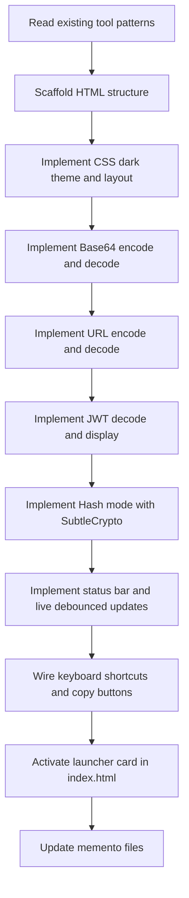

# Plan: Encoder / Decoder (`tools/encoder-decoder.html`)

## 1. Overview

A self-contained single-file HTML tool that lets developers encode, decode, inspect, and hash data across multiple formats without leaving the browser. Follows all LocalKit conventions: dark VS Code-inspired theme, vanilla JS, no CDN, no build step, single `<style>` + `<body>` + `<script>` file structure. Stateless — no `localStorage` needed.

---

## 2. Layout

```
┌─────────────────────────────────────────────────────────────────┐
│  Header: 🧰 LocalKit / 🔐 Encoder / Decoder                     │
├─────────────────────────────────────────────────────────────────┤
│  Mode Tabs (full-width tab bar)                                  │
│  [Base64] [URL] [JWT] [Hash]                                     │
├─────────────────────────────────────────────────────────────────┤
│  (Mode-specific panel fills the rest of the workspace)           │
│                                                                  │
│  Base64 / URL mode:                                              │
│  ┌──────────────────────────┬───────────────────────────────┐   │
│  │  INPUT                   │  OUTPUT                        │   │
│  │  <textarea>              │  <pre or textarea>             │   │
│  │  [Encode ▶] [◀ Decode]  │  [Copy]                        │   │
│  └──────────────────────────┴───────────────────────────────┘   │
│                                                                  │
│  JWT mode:                                                       │
│  ┌──────────────────────────────────────────────────────────┐   │
│  │  Paste JWT token (full width textarea)                    │   │
│  ├──────────────────────────────────────────────────────────┤   │
│  │  Header (JSON) │ Payload (JSON) │ Signature status        │   │
│  └──────────────────────────────────────────────────────────┘   │
│                                                                  │
│  Hash mode:                                                      │
│  ┌──────────────────────────────────────────────────────────┐   │
│  │  Input <textarea>               Algorithm: [SHA-256 ▾]   │   │
│  ├──────────────────────────────────────────────────────────┤   │
│  │  Hash Output (full-width monospace) [Copy]               │   │
│  └──────────────────────────────────────────────────────────┘   │
├─────────────────────────────────────────────────────────────────┤
│  Status bar: mode context / character counts / error messages    │
└─────────────────────────────────────────────────────────────────┘
```

---

## 3. Features

### 3.1 Base64 Mode

| Feature | Detail |
|---------|--------|
| **Encode** | Converts raw text → Base64 string via `btoa()` with UTF-8 support (`TextEncoder` + manual byte mapping) |
| **Decode** | Converts Base64 string → raw text via `atob()` with graceful error handling |
| **Live operation** | Auto-encode/decode on input after 200 ms debounce; direction toggle via `[Encode ▶]` / `[◀ Decode]` |
| **Copy output** | `navigator.clipboard` with `execCommand` fallback; `✅ Copied!` feedback 1.8 s |
| **Error state** | Invalid Base64 shows ❌ in status bar with error message |

### 3.2 URL Encode Mode

| Feature | Detail |
|---------|--------|
| **Encode** | `encodeURIComponent()` on input text |
| **Decode** | `decodeURIComponent()` with `try/catch` for malformed sequences |
| **Live operation** | Same debounced auto-run pattern as Base64 mode |
| **Copy output** | Same copy pattern |

### 3.3 JWT Decode Mode

| Feature | Detail |
|---------|--------|
| **Token input** | Single full-width textarea for the raw JWT string |
| **Header panel** | Decoded + pretty-printed JSON header (via `syntaxHighlight()`) |
| **Payload panel** | Decoded + pretty-printed JSON payload (via `syntaxHighlight()`) |
| **Signature status** | Shows `⚠️ Signature not verified` (client-side only; no secret key) |
| **Expiry check** | If `exp` claim present, shows `✅ Not expired` / `⚠️ Expired N ago` |
| **`iat` / `nbf` display** | Human-readable timestamps where present |
| **Error state** | Invalid JWT (not 3 parts, malformed base64url) shows ❌ with message |
| **Live decode** | Decodes as user types (debounced) |

### 3.4 Hash Mode

| Feature | Detail |
|---------|--------|
| **Algorithms** | SHA-256, SHA-384, SHA-512 via `SubtleCrypto` (`crypto.subtle.digest`) |
| **Input** | `<textarea>` (arbitrary text) |
| **Output** | Lowercase hex digest string in a full-width monospace `<pre>` |
| **Algorithm selector** | `<select>` — switches algorithm and re-hashes instantly |
| **Copy** | Same copy pattern |
| **Note** | `crypto.subtle` requires secure context (`https://` or `localhost`); on `file://` show a clear informational note |

### 3.5 Status Bar

Always visible at the bottom; shows contextual info per mode:
- Base64/URL: `N chars in · N chars out` or `❌ <error>`
- JWT: `✅ Valid JWT · exp: <human date>` or `❌ Invalid JWT: <reason>`
- Hash: `SHA-256 · N chars input · computed in <Xms>`

### 3.6 Keyboard Shortcuts

| Key | Action |
|-----|--------|
| `Ctrl+Enter` | Run encode/decode/hash for active mode |
| `Ctrl+Shift+C` | Copy output |
| `Escape` | Clear input and output |
| `1` / `2` / `3` / `4` | Switch to Base64 / URL / JWT / Hash tab (when not in a textarea) |

---

## 4. Technical Design

### 4.1 File

```
tools/encoder-decoder.html
├── <style>   CSS (dark theme, layout, mode panels, status bar)
├── <body>    Markup (header, tab bar, mode panels, status bar)
└── <script>  All JS logic
```

### 4.2 State Object

```js
const appState = {
  mode: 'base64',     // 'base64' | 'url' | 'jwt' | 'hash'
  direction: 'encode', // base64/url modes: 'encode' | 'decode'
  hashAlgo: 'SHA-256', // hash mode: 'SHA-256' | 'SHA-384' | 'SHA-512'
};
```

### 4.3 Core Functions

| Function | Purpose |
|----------|---------|
| `base64Encode(str)` | UTF-8 safe Base64 encode (`TextEncoder` + `Uint8Array` → `btoa`) |
| `base64Decode(str)` | `atob()` → UTF-8 string; throws on invalid input |
| `urlEncode(str)` | `encodeURIComponent(str)` |
| `urlDecode(str)` | `decodeURIComponent(str)`; throws on malformed sequences |
| `decodeJwt(token)` | Split on `.`, `atob` base64url each part, `JSON.parse`; returns `{ header, payload, rawSig }` |
| `formatJwtClaim(key, val)` | Human-readable formatting for `exp`, `iat`, `nbf` timestamps |
| `hashText(str, algo)` | `crypto.subtle.digest(algo, TextEncoder().encode(str))` → hex string (async) |
| `bufToHex(buf)` | `ArrayBuffer` → lowercase hex string |
| `syntaxHighlight(json)` | Reuse identical pattern from JSON Formatter for JWT panels |
| `renderStatusBar(msg, isError)` | Updates status bar text and error/valid styling |
| `debounce(fn, ms)` | Same utility pattern as JSON Formatter |
| `copyToClipboard(text, btn)` | `navigator.clipboard` + `execCommand` fallback; button feedback |
| `switchMode(mode)` | Show/hide mode panels; clear outputs; update tab state |

### 4.4 Base64 UTF-8 Encoding

`btoa()` only handles Latin-1 bytes. For full Unicode support:

```js
function base64Encode(str) {
  const bytes = new TextEncoder().encode(str);
  let binary = '';
  bytes.forEach(b => binary += String.fromCharCode(b));
  return btoa(binary);
}

function base64Decode(b64) {
  const binary = atob(b64);
  const bytes = Uint8Array.from(binary, c => c.charCodeAt(0));
  return new TextDecoder().decode(bytes);
}
```

### 4.5 JWT Decode

Base64url differs from Base64 (`-` → `+`, `_` → `/`, padding added):

```js
function b64urlDecode(s) {
  s = s.replace(/-/g, '+').replace(/_/g, '/');
  while (s.length % 4) s += '=';
  return atob(s);
}
```

### 4.6 Hash (async pattern)

```js
async function hashText(str, algo) {
  const buf = await crypto.subtle.digest(algo, new TextEncoder().encode(str));
  return bufToHex(buf);
}
```

`crypto.subtle` is unavailable on insecure origins (`file://`). Detection: `window.isSecureContext === false` → render informational banner instead of hash output.

### 4.7 Syntax Highlight

Port the identical `syntaxHighlight()` regex colorizer from `json-formatter.html` for use in the JWT header and payload panels.

### 4.8 CSS Architecture

Reuse the same CSS custom property palette and component classes as existing tools. Mode-specific panels are shown/hidden via `hidden` attribute (same pattern as JSON Formatter's `panels-format` / `panels-diff`).

New mode-panel layout: two-column split (`flex: 1 1 50%`) for Base64/URL modes; single-column full-width for JWT and Hash modes.

### 4.9 No localStorage

Encoder/Decoder is stateless — input is transient, no persistence needed. Consistent with Cron Helper and JSON Formatter.

---

## 5. Header / Navigation

Breadcrumb pattern consistent with all other tools:

```html
<header class="app-header">
  <a href="../index.html" class="app-header__back">🧰 LocalKit</a>
  <span class="app-header__sep">/</span>
  <span class="app-header__title">🔐 Encoder / Decoder</span>
</header>
```

---

## 6. Launcher Update (`index.html`)

Activate the Encoder / Decoder card (currently a coming-soon `<div>`):

```html
<!-- Before -->
<div class="tool-card tool-card--coming-soon">
  <span class="tool-card__icon">🔐</span>
  <span class="tool-card__name">Encoder / Decoder</span>
  <span class="tool-card__desc">Base64, URL encoding, JWT decoder, and hash generator — all in one place.</span>
  <span class="tool-card__tag tag--purple">Coming Soon</span>
</div>

<!-- After -->
<a href="tools/encoder-decoder.html" class="tool-card">
  <span class="tool-card__icon">🔐</span>
  <span class="tool-card__name">Encoder / Decoder</span>
  <span class="tool-card__desc">Base64, URL encoding, JWT decoder, and hash generator — all in one place.</span>
  <span class="tool-card__tag tag--purple">Encode · JWT · Hash</span>
</a>
```

---

## 7. Implementation Steps (Chronicle)



---

### Chronicle

Each chronicle entry is a discrete, reviewable unit of work. Implement one entry at a time; get approval before proceeding to the next.

---

#### Chronicle 1 — Scaffold & CSS

**Goal:** Create the file skeleton with full CSS and all markup in place. No JS logic yet — just the static shell that shows correct layout in the browser.

**Deliverables:**
- `tools/encoder-decoder.html` created
- `<style>` block: all CSS custom properties (reuse LocalKit palette), header, mode tab bar, two-column split panel, single-column panel, status bar, copy button states
- `<body>`: header breadcrumb, mode tab bar (`[Base64] [URL] [JWT] [Hash]`), all four mode panels (with `hidden` on all but Base64 initially), status bar
- Mode panel markup:
  - **Base64 / URL**: two-column flexbox — left `<textarea>` with `[Encode ▶]` / `[◀ Decode]` buttons, right `<pre>` output + `[Copy]`
  - **JWT**: full-width `<textarea>` input; below it three side-by-side cards: `HEADER`, `PAYLOAD`, `SIGNATURE`
  - **Hash**: full-width `<textarea>` input + algorithm `<select>`; below it full-width `<pre>` output + `[Copy]`
- Status bar: empty `<span>` slots ready for JS population
- No JS wired yet — pure markup + style pass

**Acceptance check:** Open in browser, see correct dark-themed layout; clicking mode tabs does nothing yet; all panels render without overflow or layout breaks.

---

#### Chronicle 2 — Base64 Encode / Decode

**Goal:** Fully functional Base64 tab.

**Deliverables:**
- `base64Encode(str)` — UTF-8 safe via `TextEncoder` + `btoa`
- `base64Decode(str)` — `atob` → `TextDecoder`; graceful `try/catch`
- Direction toggle: `[Encode ▶]` / `[◀ Decode]` buttons update `appState.direction` and re-run
- Live debounced (200 ms) auto-run on input `textarea` change
- Output written to right-side `<pre>`
- Status bar: `N chars in · N chars out` or `❌ <error>`
- Copy button wired for Base64 output
- `Ctrl+Enter` triggers encode/decode; `Escape` clears

**Acceptance check:**
- Type `Hello 🌍` → Encode → output is valid Base64, decode reverses it exactly
- Invalid Base64 in decode direction shows ❌ status

---

#### Chronicle 3 — URL Encode / Decode

**Goal:** Fully functional URL tab — reuses the same panel layout and helper infrastructure from Chronicle 2.

**Deliverables:**
- `urlEncode(str)` — `encodeURIComponent`
- `urlDecode(str)` — `decodeURIComponent` with `try/catch`
- Same direction toggle, live debounce, status bar, copy pattern as Base64
- Switching to URL tab clears Base64 output; switching back preserves input

**Acceptance check:**
- `hello world/foo?bar=1` → Encode → `hello%20world%2Ffoo%3Fbar%3D1`
- Decode reverses; malformed `%ZZ` shows ❌

---

#### Chronicle 4 — JWT Decode

**Goal:** Fully functional JWT tab that decodes and displays any standard JWT.

**Deliverables:**
- `b64urlDecode(s)` — base64url → string (handle `+`, `/`, padding)
- `decodeJwt(token)` — split on `.`, decode header + payload, return `{ header, payload, rawSig }`
- `formatJwtClaim(key, val)` — `exp` / `iat` / `nbf` shown as `<timestamp> (human-readable date)`
- Header panel: `syntaxHighlight()` JSON output in `<pre>`
- Payload panel: `syntaxHighlight()` JSON output with human-readable claim annotations
- Signature panel: always shows `⚠️ Signature not verified (client-side only)`
- Expiry indicator in status bar: `✅ Not expired · exp: <date>` or `⚠️ Expired <N ago>`
- Live decode on input (debounced 200 ms)
- Error state: `❌ Invalid JWT: <reason>` in status bar + red border on textarea

**Acceptance check:**
- Paste a real JWT → header and payload decoded and syntax-highlighted
- `exp` in the past shows expired warning
- A malformed token (2 parts, invalid base64url) shows ❌

---

#### Chronicle 5 — Hash Mode

**Goal:** Fully functional Hash tab using `SubtleCrypto`.

**Deliverables:**
- `hashText(str, algo)` — async `crypto.subtle.digest`; returns hex string
- `bufToHex(buf)` — `ArrayBuffer` → lowercase hex
- Algorithm `<select>` with SHA-256, SHA-384, SHA-512; switching re-hashes immediately
- Output to full-width `<pre>` in monospace
- `isSecureContext` check: if `false`, show an informational banner (`ℹ️ Hash requires a secure context (HTTPS or localhost). File:// protocol is not supported.`) and disable the hash output area
- Status bar: `SHA-256 · N chars · computed in <Xms>`
- Copy button wired
- Live hash on input change (debounced 200 ms, re-fires on algorithm change)

**Acceptance check:**
- `hello` with SHA-256 produces `2cf24dba5fb0a30e26e83b2ac5b9e29e1b161e5c1fa7425e73043362938b9824`
- Algorithm switch immediately updates output
- On `file://`, informational banner is shown instead of attempting to hash

---

#### Chronicle 6 — Mode Switcher, Status Bar & Keyboard Shortcuts

**Goal:** Wire the mode tab bar, unify the status bar helper, and implement all keyboard shortcuts.

**Deliverables:**
- `switchMode(mode)` — shows/hides panels, clears output, updates tab `--active` state, focuses primary input of new mode
- Mode tab bar click handlers
- Unified `renderStatusBar(msg, isError)` used by all four modes
- Keyboard shortcuts:
  - `Ctrl+Enter` → run active mode action
  - `Ctrl+Shift+C` → copy active output
  - `Escape` → clear active panel input + output
  - `1` / `2` / `3` / `4` → switch mode (when `document.activeElement` is not a textarea/select)
- All copy buttons: `copyToClipboard(text, btn)` helper with `navigator.clipboard` + `execCommand` fallback + `✅ Copied!` 1.8 s feedback

**Acceptance check:**
- Tab switching works cleanly; each mode's state is independent
- `1` key from anywhere outside a textarea switches to Base64 tab
- `Ctrl+Enter` in JWT mode re-decodes; in Hash mode re-hashes
- `Escape` clears all panels in active mode

---

#### Chronicle 7 — Launcher Activation & Memento Update

**Goal:** Activate the `index.html` card and keep documentation current.

**Deliverables:**
- `index.html`: replace coming-soon `<div>` for Encoder/Decoder with active `<a>` tag (tag text: `Encode · JWT · Hash`, class `tag--purple`)
- `memento/activeContext.md`: update current focus to Encoder/Decoder complete; next steps = Markdown Preview
- `memento/progress.md`: mark Tool 5 (Encoder/Decoder) as ✅ COMPLETE with full feature list; update "Next Up" to Markdown Preview
- `memento/projectbrief.md`: update planned tools section (Encoder/Decoder → complete)
- `memento/systemPatterns.md`: add encoder-decoder file to architecture overview

**Acceptance check:**
- `index.html` loads; Encoder/Decoder card is clickable and links to `tools/encoder-decoder.html`
- All memento files accurately reflect current state

---

## 8. Acceptance Criteria

- [ ] **Base64 Encode** — arbitrary Unicode text (including emoji) encodes to valid Base64
- [ ] **Base64 Decode** — valid Base64 decodes back to original text; invalid input shows ❌
- [ ] **URL Encode** — `encodeURIComponent` output shown; special chars correctly escaped
- [ ] **URL Decode** — decodes percent-encoded strings; malformed sequences show ❌
- [ ] **JWT** — pasting any valid JWT shows syntax-highlighted header and payload; `exp` expiry shown
- [ ] **JWT invalid** — non-JWT input shows ❌ with reason
- [ ] **Hash SHA-256** — `hello` produces the correct digest
- [ ] **Hash algorithm switch** — changing algorithm immediately re-hashes
- [ ] **Hash on `file://`** — informational banner shown; no silent failure
- [ ] **Copy** — each mode's copy button copies correct output; `✅ Copied!` feedback shown
- [ ] **Live debounce** — output updates automatically without clicking a button (200 ms)
- [ ] **Mode switching** — tabs switch cleanly; each mode is independent
- [ ] **Keyboard shortcuts** — `Ctrl+Enter`, `Ctrl+Shift+C`, `Escape`, `1`–`4` all work as specified
- [ ] **Status bar** — shows contextual info for each mode; errors styled in red
- [ ] **Breadcrumb** — `🧰 LocalKit` navigates back to `index.html`
- [ ] **Launcher card** — `index.html` Encoder/Decoder card is active (links to tool)
- [ ] **Self-contained** — no external dependencies, no CDN, no build step

---

## 9. Out of Scope (this iteration)

- MD5 / SHA-1 hashing (not available via `SubtleCrypto` in all contexts; adds complexity without much value)
- JWT signature verification (requires HMAC secret or RSA public key — outside browser-local scope)
- File input (encode/hash a file) — paste-only for now
- HTML entity encode/decode
- Binary / hex view of Base64 decoded bytes
- Export output as file