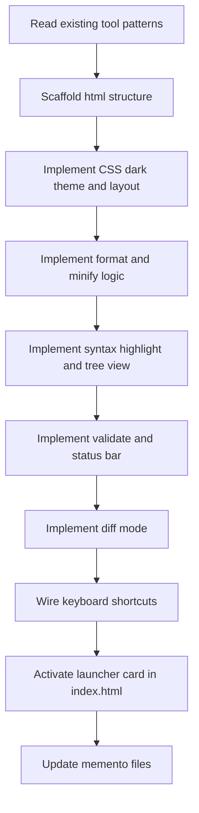

# Plan: JSON Formatter (`tools/json-formatter.html`)

## 1. Overview

A self-contained single-file HTML tool that lets developers paste, format, validate, and explore JSON. Follows all LocalKit conventions: dark VS Code-inspired theme, vanilla JS, no CDN, no build step, single `<style>` + `<body>` + `<script>` file structure.

---

## 2. Layout

```
┌─────────────────────────────────────────────────────────────────┐
│  Header: 🧰 LocalKit / 📋 JSON Formatter                        │
├─────────────────────────────────────────────────────────────────┤
│  Action Bar                                                      │
│  [Format] [Minify] [Validate] [Clear]    Mode: [Format|Diff ▾]  │
├──────────────────────────────┬──────────────────────────────────┤
│  INPUT PANEL                 │  OUTPUT PANEL                    │
│  ─────────────               │  ─────────────                   │
│  <textarea>                  │  Tabs: [Pretty] [Tree] [Raw]     │
│  (paste raw JSON here)       │  ─────────────────────────────   │
│                              │  <output content area>           │
│                              │  (syntax-highlighted / tree /    │
│                              │   raw text)                      │
├──────────────────────────────┴──────────────────────────────────┤
│  Status bar: ✅ Valid JSON  ·  42 keys  ·  3 levels deep        │
└─────────────────────────────────────────────────────────────────┘
```

### Diff Mode Layout (mode switch)

```
┌─────────────────────────────────────────────────────────────────┐
│  Header: 🧰 LocalKit / 📋 JSON Formatter                        │
├─────────────────────────────────────────────────────────────────┤
│  Action Bar                                                      │
│  [Compare]  [Swap]  [Clear Both]         Mode: [Format|Diff ▾]  │
├──────────────────────────────┬──────────────────────────────────┤
│  LEFT (A)                    │  RIGHT (B)                       │
│  <textarea label="JSON A">   │  <textarea label="JSON B">       │
├──────────────────────────────┴──────────────────────────────────┤
│  DIFF RESULT (full width)                                        │
│  Side-by-side highlighted diff output                           │
└─────────────────────────────────────────────────────────────────┘
```

---

## 3. Features

### 3.1 Format Mode (default)

| Feature | Detail |
|---------|--------|
| **Paste & Format** | User pastes raw/minified JSON into the textarea; clicking **Format** pretty-prints with 2-space indent |
| **Minify** | Strips all whitespace, outputs compact single-line JSON |
| **Validate** | Runs `JSON.parse()` on input; shows ✅ or ❌ + error message + approximate error line/col |
| **Clear** | Clears both input textarea and output panel |
| **Auto-validate on input** | Status bar updates live as user types (debounced 300 ms) with validity + stats |
| **Copy output** | Copy button on the output panel; uses `navigator.clipboard` with `execCommand` fallback |

### 3.2 Output Tabs

| Tab | Behaviour |
|-----|-----------|
| **Pretty** | Syntax-highlighted formatted JSON (same regex colorizer pattern as API Client) |
| **Tree** | Collapsible key-value tree (same recursive DOM builder pattern as API Client) |
| **Raw** | Plain monospace text, no highlighting |

### 3.3 Diff Mode

| Feature | Detail |
|---------|--------|
| **Two input textareas** | JSON A (left) and JSON B (right) |
| **Compare** | Parses both; shows structural diff — keys added (green), removed (red), changed (yellow), unchanged (dim) |
| **Swap** | Swaps content of A and B textareas |
| **Clear Both** | Clears both inputs and diff result |
| **Validation per input** | Each textarea shows its own validity badge |

### 3.4 Status Bar

Always visible below the panels; shows:
- `✅ Valid JSON` or `❌ Invalid: Unexpected token … at line N`
- Key count (top-level keys or total keys across document)
- Max nesting depth
- Character / byte count of input

### 3.5 Keyboard Shortcuts

| Key | Action |
|-----|--------|
| `Ctrl+Enter` | Format |
| `Ctrl+M` | Minify |
| `Ctrl+Shift+C` | Copy output |
| `Escape` | Clear input |

---

## 4. Technical Design

### 4.1 File

```
tools/json-formatter.html
├── <style>   CSS (dark theme, layout, syntax colors, diff colors)
├── <body>    Markup (header, action bar, panels, status bar)
└── <script>  All JS logic
```

### 4.2 State Object

```js
const appState = {
  mode: 'format',       // 'format' | 'diff'
  outputTab: 'pretty',  // 'pretty' | 'tree' | 'raw'
  input: '',            // raw textarea content (format mode)
  inputA: '',           // diff mode left textarea
  inputB: '',           // diff mode right textarea
  parsed: null,         // last successfully parsed value
  error: null,          // parse error string or null
};
```

### 4.3 Core Functions

| Function | Purpose |
|----------|---------|
| `parseInput(str)` | Wraps `JSON.parse()`; returns `{ ok, value, error }` |
| `formatJSON(value)` | `JSON.stringify(value, null, 2)` |
| `minifyJSON(value)` | `JSON.stringify(value)` |
| `syntaxHighlight(str)` | Regex colorizer → HTML string (reuse API Client pattern) |
| `buildJsonTree(value, container)` | Recursive collapsible DOM tree (reuse API Client pattern) |
| `computeStats(value)` | Returns `{ keyCount, maxDepth, charCount }` |
| `diffJSON(a, b)` | Recursive structural diff → array of `{ path, type, aVal, bVal }` change descriptors |
| `renderDiff(changes)` | Renders side-by-side diff HTML from change descriptors |
| `renderOutput()` | Switches output panel content based on `appState.outputTab` |
| `renderStatusBar()` | Updates validity + stats display |
| `initTabs(navEl, getPanelId)` | Generic tab switcher (same as other tools) |
| `debounce(fn, ms)` | Utility for live-validation on input events |

### 4.4 Diff Algorithm

- Deep-recursive comparison of two parsed JSON values
- Change types: `added` | `removed` | `changed` | `unchanged`
- Path tracking: dot-notation for objects (`a.b.c`), bracket-notation for arrays (`a[0]`)
- Output: flat list of `{ path, type, aVal, bVal }` descriptors
- Render as a two-column table — left column (A) / right column (B), rows colored by change type

### 4.5 Syntax Highlight Colors

Reuse the same CSS custom properties pattern; add diff-specific colors:

```css
--json-key:      #9cdcfe;   /* object keys  */
--json-string:   #ce9178;   /* string values */
--json-number:   #b5cea8;   /* numbers */
--json-bool:     #569cd6;   /* true / false */
--json-null:     #569cd6;   /* null */
--json-punct:    #d4d4d4;   /* { } [ ] : , */

--diff-added:    rgba(78, 201, 176, 0.15);   /* green tint */
--diff-removed:  rgba(244, 71, 71, 0.15);    /* red tint */
--diff-changed:  rgba(220, 220, 170, 0.15);  /* yellow tint */
```

### 4.6 No localStorage

JSON Formatter is stateless — no persistence needed. Input is transient (session only). This is consistent with Cron Helper.

---

## 5. Header / Navigation

Breadcrumb pattern consistent with other tools:

```html
<header>
  <a href="../index.html">🧰 LocalKit</a>
  <span>/</span>
  <span>📋 JSON Formatter</span>
</header>
```

---

## 6. Launcher Update (`index.html`)

Activate the JSON Formatter card (currently a coming-soon `<div>`):

```html
<!-- Before -->
<div class="tool-card tool-card--coming-soon">
  ...
</div>

<!-- After -->
<a href="tools/json-formatter.html" class="tool-card">
  <span class="tool-card__icon">📋</span>
  <span class="tool-card__name">JSON Formatter</span>
  <span class="tool-card__desc">Paste, format, and validate JSON. Collapsible tree view, schema inspector, diff mode.</span>
  <span class="tool-card__tag tag--yellow">JSON · Diff</span>
</a>
```

---

## 7. Implementation Steps



### Step-by-step

1. **Scaffold** — Create `tools/json-formatter.html` with header, action bar, split panels, status bar, and output tabs markup
2. **CSS** — Dark theme variables, two-panel split layout (50/50 flexbox), tab bar, status bar, diff table, responsive collapse on narrow viewports
3. **Format / Minify** — `parseInput`, `formatJSON`, `minifyJSON`, wire Format and Minify buttons, populate output Pretty/Raw tabs
4. **Syntax Highlight** — Port `syntaxHighlight()` regex colorizer into this file for Pretty tab
5. **Tree View** — Port `buildJsonTree()` recursive DOM builder for Tree tab
6. **Stats & Status Bar** — `computeStats()`, live debounced validation on textarea `input` event
7. **Diff Mode** — Mode switcher UI, `diffJSON()` recursive diff, `renderDiff()` two-column table renderer, Swap + Clear Both buttons
8. **Keyboard Shortcuts** — `keydown` listener for `Ctrl+Enter`, `Ctrl+M`, `Ctrl+Shift+C`, `Escape`
9. **Copy Button** — `navigator.clipboard` with `execCommand` fallback, brief "✅ Copied!" state on button
10. **Launcher** — Replace coming-soon `<div>` with active `<a>` card in `index.html`
11. **Memento** — Update `activeContext.md`, `progress.md`, `projectbrief.md`, `systemPatterns.md` to mark JSON Formatter as complete

---

## 8. Acceptance Criteria

- [ ] Pasting valid JSON and clicking **Format** produces indented, syntax-highlighted output in Pretty tab
- [ ] **Minify** produces compact single-line JSON in output
- [ ] Pasting invalid JSON shows ❌ error with message and approximate location in status bar
- [ ] **Tree** tab shows collapsible nodes; click to expand/collapse; objects and arrays distinguishable
- [ ] **Raw** tab shows plain pre-formatted text
- [ ] **Copy** button copies current output text; shows brief ✅ feedback
- [ ] **Diff mode** — pasting two valid JSONs and clicking Compare shows additions, removals, changes colour-coded
- [ ] **Swap** exchanges content between A and B textareas
- [ ] Status bar updates live (debounced) as user types in format mode
- [ ] `Ctrl+Enter` triggers Format; `Ctrl+M` triggers Minify; `Escape` clears input
- [ ] Breadcrumb `🧰 LocalKit` navigates back to `index.html`
- [ ] `index.html` JSON Formatter card is active (links to `tools/json-formatter.html`)
- [ ] Tool is entirely self-contained — no external dependencies, no CDN

---

## 9. Out of Scope (for this iteration)

- JSON Schema validation (validate against a schema document)
- JSONPath query / search
- Persistent history of previous inputs
- File upload (paste-only input)
- Export formatted output as `.json` file *(nice-to-have, low priority)*