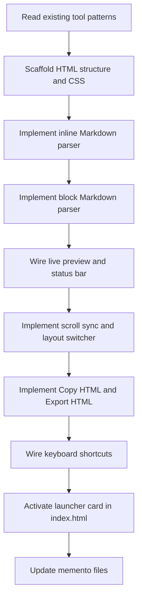

# Plan: Markdown Preview (`tools/markdown-preview.html`)

## 1. Overview

A self-contained single-file HTML tool that lets developers write Markdown and see a live rendered preview side-by-side — entirely in the browser, with no CDN or build step. Follows all LocalKit conventions: dark VS Code-inspired theme, vanilla JS, no external dependencies, single `<style>` + `<body>` + `<script>` file structure. Stateless — no `localStorage` needed.

The Markdown parser is implemented from scratch in vanilla JS (no third-party libraries). It supports the common subset of CommonMark that developers use most: headings, bold, italic, strikethrough, inline code, fenced code blocks, blockquotes, ordered and unordered lists, horizontal rules, links, images, and tables.

---

## 2. Layout

```
┌─────────────────────────────────────────────────────────────────┐
│  Header: 🧰 LocalKit / 📝 Markdown Preview                      │
├─────────────────────────────────────────────────────────────────┤
│  Action Bar                                                      │
│  [Copy HTML] [Export HTML] [Clear]     [Word Wrap ▾] [Layout ▾] │
├──────────────────────────────┬──────────────────────────────────┤
│  EDITOR PANEL                │  PREVIEW PANEL                   │
│  ─────────────               │  ─────────────                   │
│  <textarea>                  │  <div class="md-body">           │
│  (Markdown source)           │  (rendered HTML)                 │
│                              │                                  │
│                              │                                  │
├──────────────────────────────┴──────────────────────────────────┤
│  Status bar: N lines · N words · N chars                        │
└─────────────────────────────────────────────────────────────────┘
```

### Layout Modes

| Mode | Description |
|------|-------------|
| **Split** (default) | Editor left, preview right — 50 / 50 flex split |
| **Editor only** | Full-width textarea; preview hidden |
| **Preview only** | Full-width preview; editor hidden |

---

## 3. Features

### 3.1 Live Preview

| Feature | Detail |
|---------|--------|
| **Auto-render** | Preview updates as user types — debounced 200 ms |
| **Split pane** | Editor and preview side-by-side at 50/50 width |
| **Scroll sync** | Scrolling the editor scrolls the preview proportionally (and vice versa) |
| **Layout switcher** | Toggle between Split / Editor only / Preview only via action bar dropdown |

### 3.2 Markdown Parser

Implemented entirely in vanilla JS with no third-party dependencies. Supports:

| Element | Syntax |
|---------|--------|
| **Headings** | `# H1` through `###### H6` |
| **Bold** | `**text**` or `__text__` |
| **Italic** | `*text*` or `_text_` |
| **Bold + Italic** | `***text***` |
| **Strikethrough** | `~~text~~` |
| **Inline code** | `` `code` `` |
| **Fenced code block** | ```` ```lang ... ``` ```` — language label shown as badge |
| **Blockquote** | `> text` — nestable |
| **Unordered list** | `- item` / `* item` / `+ item` — nestable |
| **Ordered list** | `1. item` — nestable |
| **Horizontal rule** | `---` / `***` / `___` |
| **Link** | `[label](url)` — opens in new tab |
| **Image** | `` |
| **Table** | GFM-style pipe tables with optional alignment row |
| **Blank lines** | Two or more consecutive blank lines produce a paragraph break |
| **Line breaks** | Trailing two spaces on a line → `<br>` |

### 3.3 Copy HTML

| Feature | Detail |
|---------|--------|
| **Copy rendered HTML** | Copies the innerHTML of the preview container to clipboard |
| **`navigator.clipboard`** | With `execCommand` fallback for `file://` protocol |
| **Feedback** | `✅ Copied!` for 1.8 s on the button |

### 3.4 Export HTML

| Feature | Detail |
|---------|--------|
| **Export as `.html` file** | Wraps rendered HTML in a minimal standalone HTML document (with inline styles for the prose theme) and triggers a download via `Blob + URL.createObjectURL` |
| **Filename** | `markdown-export-YYYY-MM-DD.html` |
| **Standalone output** | Exported file includes a `<style>` block with the same prose typography — readable in any browser without LocalKit |

### 3.5 Status Bar

Always visible at the bottom; shows:
- `N lines · N words · N chars` — counts derived from the raw Markdown source

### 3.6 Word Wrap Toggle

- Checkbox-style toggle in the action bar
- When **on** (default): textarea has `word-wrap: break-word; white-space: pre-wrap`
- When **off**: textarea uses `white-space: pre; overflow-x: auto` (useful for wide tables)

### 3.7 Clear

- Clears the editor textarea and resets the preview to empty
- `Escape` key shortcut (when not inside a focusable input — or double-Escape)

### 3.8 Keyboard Shortcuts

| Key | Action |
|-----|--------|
| `Ctrl+Shift+C` | Copy rendered HTML to clipboard |
| `Ctrl+Shift+E` | Export as HTML file |
| `Escape` | Clear editor and preview |
| `Tab` in editor | Insert 2 spaces (prevent focus loss) |

---

## 4. Technical Design

### 4.1 File

```
tools/markdown-preview.html
├── <style>   CSS (dark theme, split layout, prose typography for preview)
├── <body>    Markup (header, action bar, split panels, status bar)
└── <script>  All JS logic
```

### 4.2 State Object

```js
const appState = {
  layout:   'split',   // 'split' | 'editor' | 'preview'
  wordWrap: true,
};
```

### 4.3 Core Functions

| Function | Purpose |
|----------|---------|
| `parseMarkdown(src)` | Full Markdown → HTML string; orchestrates block and inline parsing |
| `parseBlocks(lines)` | Identify and convert block-level elements (headings, code blocks, blockquotes, lists, tables, paragraphs, HRs) |
| `parseInline(text)` | Convert inline Markdown to HTML (bold, italic, code, links, images, strikethrough) |
| `renderPreview()` | Sets `previewEl.innerHTML = parseMarkdown(textarea.value)` |
| `renderStatusBar()` | Counts lines, words, chars from raw source |
| `copyHTML()` | `navigator.clipboard` + `execCommand` fallback; button feedback |
| `exportHTML()` | Wraps rendered HTML in standalone document; `Blob` download |
| `switchLayout(mode)` | Shows/hides editor + preview panels; updates dropdown state |
| `syncScroll(source)` | Proportional scroll sync between editor and preview |
| `debounce(fn, ms)` | Standard debounce utility (same pattern as other tools) |

### 4.4 Markdown Parser Design

The parser operates in two passes:

**Pass 1 — Block pass** (`parseBlocks`):
- Input: raw source split into lines
- Identifies block-level constructs in priority order:
  1. Fenced code block (``` ` ```lang ... ``` ` ```) — verbatim content, no inline parsing inside
  2. ATX heading (`# … ######`)
  3. Horizontal rule (`---`, `***`, `___` on their own line)
  4. Blockquote (`>` prefix lines — recursive call for nested content)
  5. Unordered list (`- `, `* `, `+ ` prefix) — recursive for nesting
  6. Ordered list (`N. ` prefix) — recursive for nesting
  7. GFM table (pipe-delimited rows with separator row)
  8. Blank line → paragraph boundary
  9. Default: paragraph — collects lines until blank, then runs inline pass
- Output: HTML string

**Pass 2 — Inline pass** (`parseInline`):
- Input: a single text segment (never called inside fenced code blocks)
- Applies regex replacements in safe order:
  1. Escape HTML entities (`&`, `<`, `>`) — must be first
  2. Inline code (`` `code` ``) — extract and protect from further processing
  3. Images `` — before links to avoid conflict
  4. Links `[label](url)`
  5. Bold+Italic `***text***`
  6. Bold `**text**` / `__text__`
  7. Italic `*text*` / `_text_`
  8. Strikethrough `~~text~~`
  9. Hard line break (trailing `  ` → `<br>`)

### 4.5 Prose Typography CSS

The preview panel uses a `.md-body` class with purpose-built prose styles:

```css
.md-body {
  font-family: -apple-system, BlinkMacSystemFont, 'Segoe UI', sans-serif;
  font-size: 15px;
  line-height: 1.7;
  color: #d4d4d4;
  max-width: 720px;          /* comfortable reading width */
  padding: 24px 28px;
}

/* Headings — VS Code doc style */
.md-body h1, .md-body h2 { border-bottom: 1px solid #3e3e3e; padding-bottom: 6px; }
.md-body h1 { font-size: 2em;   margin: 0.67em 0; }
.md-body h2 { font-size: 1.5em; margin: 0.83em 0; }
.md-body h3 { font-size: 1.25em; }
.md-body h4, .md-body h5, .md-body h6 { font-size: 1em; }

/* Inline code */
.md-body code { background: #2d2d2d; border-radius: 3px; padding: 1px 5px; font-family: var(--font-mono); font-size: 0.88em; color: #ce9178; }

/* Fenced code block */
.md-body pre { background: #1e1e1e; border: 1px solid #3e3e3e; border-radius: 6px; padding: 14px; overflow-x: auto; }
.md-body pre code { background: none; padding: 0; font-size: 13px; color: #d4d4d4; }
.md-body pre .code-lang { font-size: 10px; color: #6b6b6b; float: right; }

/* Blockquote */
.md-body blockquote { border-left: 3px solid #007acc; margin: 0; padding: 2px 16px; color: #9d9d9d; }

/* Tables */
.md-body table { border-collapse: collapse; width: 100%; }
.md-body th, .md-body td { border: 1px solid #3e3e3e; padding: 6px 12px; text-align: left; }
.md-body th { background: #2d2d2d; font-weight: 600; }
.md-body tr:nth-child(even) { background: rgba(255,255,255,0.03); }

/* Links */
.md-body a { color: #4ec9b0; text-decoration: none; }
.md-body a:hover { text-decoration: underline; }

/* HR */
.md-body hr { border: none; border-top: 1px solid #3e3e3e; margin: 1.5em 0; }
```

### 4.6 Export Standalone HTML

The exported file wraps rendered HTML in a complete `<!DOCTYPE html>` document with an inlined `<style>` block containing the prose typography (same CSS vars from §4.5), so the output renders correctly in any browser without LocalKit:

```js
function exportHTML() {
  const body   = previewEl.innerHTML;
  const styles = getProseCSS(); // inline string of .md-body styles
  const html   = `<!DOCTYPE html>
<html lang="en">
<head>
  <meta charset="UTF-8" />
  <meta name="viewport" content="width=device-width, initial-scale=1.0" />
  <title>Markdown Export</title>
  <style>
    body { background: #1e1e1e; margin: 0; padding: 24px; }
    ${styles}
  </style>
</head>
<body class="md-body">${body}</body>
</html>`;
  const blob = new Blob([html], { type: 'text/html' });
  const url  = URL.createObjectURL(blob);
  const a    = document.createElement('a');
  a.href     = url;
  a.download = 'markdown-export-' + new Date().toISOString().slice(0, 10) + '.html';
  a.click();
  URL.revokeObjectURL(url);
}
```

### 4.7 Scroll Sync

Proportional scroll sync between editor and preview:

```js
function syncScroll(source, target) {
  const pct = source.scrollTop / (source.scrollHeight - source.clientHeight || 1);
  target.scrollTop = pct * (target.scrollHeight - target.clientHeight);
}
```

Wired via `scroll` events on both the editor textarea and the preview div (with a lock flag to prevent infinite loops).

### 4.8 CSS Architecture

Reuses the same CSS custom property palette as existing tools. The split-panel layout mirrors `json-formatter.html` exactly:

- `.workspace` — `flex: 1; display: flex; flex-direction: column; overflow: hidden`
- `.panels` — `flex: 1; display: flex; gap: 0; overflow: hidden`
- `.panel` — `flex: 1; display: flex; flex-direction: column; overflow: hidden`
- `.panel + .panel` — `border-left: 1px solid var(--border)`

Layout modes managed via `hidden` attribute on each panel (same pattern as JSON Formatter diff mode).

### 4.9 No localStorage

Markdown Preview is stateless — input is transient, no persistence needed. Consistent with JSON Formatter, Cron Helper, and Encoder/Decoder.

---

## 5. Header / Navigation

Breadcrumb pattern consistent with all other tools:

```html
<header class="app-header">
  <a href="../index.html" class="app-header__back">🧰 LocalKit</a>
  <span class="app-header__sep">/</span>
  <span class="app-header__title">📝 Markdown Preview</span>
</header>
```

---

## 6. Launcher Update (`index.html`)

Activate the Markdown Preview card (currently a coming-soon `<div>`):

```html
<!-- Before -->
<div class="tool-card tool-card--coming-soon">
  <span class="tool-card__icon">📝</span>
  <span class="tool-card__name">Markdown Preview</span>
  <span class="tool-card__desc">Write and preview Markdown with split-pane editor. Export to HTML or copy rendered output.</span>
  <span class="tool-card__tag tag--green">Coming Soon</span>
</div>

<!-- After -->
<a href="tools/markdown-preview.html" class="tool-card">
  <span class="tool-card__icon">📝</span>
  <span class="tool-card__name">Markdown Preview</span>
  <span class="tool-card__desc">Write and preview Markdown with split-pane editor. Export to HTML or copy rendered output.</span>
  <span class="tool-card__tag tag--green">Markdown · Export</span>
</a>
```

---

## 7. Implementation Steps (Chronicle)



---

### Chronicle

Each chronicle entry is a discrete, reviewable unit of work. Implement one entry at a time; get approval before proceeding to the next.

---

#### Chronicle 1 — Scaffold & CSS

**Goal:** Create the file skeleton with full CSS and all markup in place. No JS logic yet — just the static shell that shows correct layout in the browser.

**Deliverables:**
- `tools/markdown-preview.html` created
- `<style>` block:
  - All CSS custom properties (reuse LocalKit palette)
  - Header, action bar, split-panel layout (mirrors `json-formatter.html`)
  - `.md-body` prose typography (§4.5) — all heading styles, code, pre, blockquote, table, link, HR
  - Status bar (30 px, blue background — same as JSON Formatter)
  - `.btn`, `.btn--primary`, `.btn--copy`, `.btn--copied` — same component classes
  - Layout mode: `.panel--hidden` utility (or use `hidden` attribute)
  - Word-wrap toggle button style
- `<body>`:
  - Header breadcrumb (`🧰 LocalKit / 📝 Markdown Preview`)
  - Action bar: `[Copy HTML]` `[Export HTML]` `[Clear]` | `[Word Wrap]` | `Layout: [Split ▾]` dropdown
  - Split workspace: left panel (panel title "MARKDOWN", `<textarea id="md-input">`) + right panel (panel title "PREVIEW", `<div id="md-preview" class="md-body">`)
  - Status bar: `<span id="status-lines">` `·` `<span id="status-words">` `·` `<span id="status-chars">`
- No JS wired yet — pure markup + style pass

**Acceptance check:** Open in browser, see correct dark-themed split layout; textarea on left, empty preview div on right; action bar buttons visible; status bar at bottom. No JS errors in console.

---

#### Chronicle 2 — Inline Markdown Parser

**Goal:** Implement and test `parseInline(text)` — all inline Markdown elements correctly converted to HTML.

**Deliverables:**
- `escHtml(str)` — escape `&`, `<`, `>` (same helper as json-formatter)
- `parseInline(text)` with all inline rules in safe application order:
  1. HTML entity escaping
  2. Inline code extraction (protect from further processing — use placeholder tokens)
  3. Images ``
  4. Links `[label](url)` — `target="_blank" rel="noopener"`
  5. Bold + Italic `***text***`
  6. Bold `**text**` / `__text__`
  7. Italic `*text*` / `_text_`
  8. Strikethrough `~~text~~`
  9. Hard line breaks (trailing `  ` → `<br>`)
  10. Restore inline code placeholders

**Acceptance check (test by calling from browser console):**
- `parseInline('**bold** and _italic_')` → `<strong>bold</strong> and <em>italic</em>`
- `parseInline('`code` here')` → `` <code>code</code> here ``
- `parseInline('[link](https://example.com)')` → `<a href="https://example.com" ...>link</a>`
- `parseInline('~~strike~~')` → `<del>strike</del>`
- `parseInline('<script>')` → `<script>` (XSS safety)

---

#### Chronicle 3 — Block Markdown Parser

**Goal:** Implement `parseBlocks(lines)` — all block-level elements correctly identified and converted to HTML, calling `parseInline` for paragraph/heading content.

**Deliverables:**
- `parseBlocks(lines)` processing in priority order:
  1. **Fenced code block** — ```` ``` ```` open/close; language badge from info string; content escaped but not inline-parsed
  2. **ATX heading** — `#` through `######`; inline-parse the heading text
  3. **Horizontal rule** — `---` / `***` / `___` on their own line (3+ chars)
  4. **Blockquote** — strip `>` prefix; recursive `parseBlocks` for content
  5. **Unordered list** — `- `, `* `, `+ ` prefix; nested via indentation
  6. **Ordered list** — `N. ` prefix; nested via indentation
  7. **GFM table** — detect pipe row + separator row; parse alignment; render `<table>`
  8. **Paragraph** — collect lines until blank line; `parseInline` the joined text
- `parseMarkdown(src)` — entry point: splits src into lines, calls `parseBlocks`, returns HTML string

**Acceptance check:**
- `# Heading` → `<h1>Heading</h1>`
- `> quote` → `<blockquote><p>quote</p></blockquote>`
- Fenced code block with ` ```js ` label → `<pre>` with language badge
- `- a\n- b` → `<ul><li>a</li><li>b</li></ul>`
- `| A | B |\n|---|---|\n| 1 | 2 |` → `<table>...</table>`
- Plain paragraph text passes through `parseInline` correctly

---

#### Chronicle 4 — Live Preview & Status Bar

**Goal:** Wire the editor textarea to the live preview panel and status bar — the core interactive loop of the tool.

**Deliverables:**
- `renderPreview()` — sets `previewEl.innerHTML = parseMarkdown(editorEl.value)`; called debounced (200 ms) on `textarea` `input` event
- `renderStatusBar()` — counts lines (`src.split('\n').length`), words (split on whitespace), chars (`src.length`); updates status bar spans
- Initial render on page load (handle the empty state: preview shows a placeholder `<p class="md-placeholder">Start typing Markdown…</p>` when editor is empty)
- Placeholder disappears as soon as the user types any character
- Word-wrap toggle wired: clicking `[Word Wrap]` button toggles `appState.wordWrap`; updates textarea CSS class accordingly

**Acceptance check:**
- Type `# Hello` in editor → preview immediately shows `<h1>Hello</h1>` (within 200 ms debounce)
- Status bar shows correct line/word/char counts updating live
- Empty editor shows placeholder text in preview
- Word-wrap toggle visibly changes textarea wrapping behaviour

---

#### Chronicle 5 — Scroll Sync & Layout Switcher

**Goal:** Implement proportional scroll synchronisation between editor and preview, and the layout switcher dropdown.

**Deliverables:**
- `syncScroll(source, target)` — proportional scroll (§4.7); with `_scrollLock` flag to prevent event loop
- Scroll sync wired: editor `scroll` event → sync to preview; preview `scroll` event → sync to editor
- `switchLayout(mode)` — shows/hides editor and preview panels based on `'split'` / `'editor'` / `'preview'`; updates `appState.layout`; re-renders status bar counts after switch
- Layout `<select>` in action bar wired to `switchLayout`
- In **Editor only** mode: preview hidden, editor takes full width
- In **Preview only** mode: editor hidden, preview takes full width; action bar `[Copy HTML]` / `[Export HTML]` remain visible
- In **Split** mode: both panels visible at 50/50

**Acceptance check:**
- Paste 200 lines of Markdown; scroll editor down → preview scrolls proportionally
- Switch to Preview Only → editor hidden, preview full width
- Switch back to Split → both panels visible; content intact

---

#### Chronicle 6 — Copy HTML, Export HTML & Keyboard Shortcuts

**Goal:** Implement the two output actions (copy and export) and all keyboard shortcuts.

**Deliverables:**
- `copyHTML()` — copies `previewEl.innerHTML` to clipboard via `navigator.clipboard` + `execCommand` fallback; `[Copy HTML]` button shows `✅ Copied!` for 1.8 s then resets
- `exportHTML()` — wraps rendered HTML in standalone document with inlined prose CSS (§4.6); downloads as `markdown-export-YYYY-MM-DD.html` via `Blob + URL.createObjectURL`
- `handleClear()` — clears textarea, resets preview to placeholder, resets status bar; `Escape` key triggers this
- `Tab` key in editor textarea — prevented from moving focus; inserts 2 spaces at cursor position instead
- Keyboard shortcuts wired (`keydown` on `document`):
  - `Ctrl+Shift+C` → `copyHTML()`
  - `Ctrl+Shift+E` → `exportHTML()`
  - `Escape` → `handleClear()` (only when editor is not a focused textarea or after double-press; to avoid blocking normal use — use single Escape but only if textarea is not the active element, else require Ctrl+Escape or wire a dedicated Clear button)
- Clear button in action bar always available regardless of `Escape` behaviour

**Acceptance check:**
- Type some Markdown; click `[Copy HTML]` → button shows `✅ Copied!`; paste into a text editor → confirms raw HTML
- Click `[Export HTML]` → file `markdown-export-YYYY-MM-DD.html` downloads; open in browser → renders correctly with dark background
- `Tab` in editor inserts 2 spaces, does not move focus
- `Ctrl+Shift+C` copies HTML; `Ctrl+Shift+E` triggers download

---

#### Chronicle 7 — Launcher Activation & Memento Update

**Goal:** Activate the `index.html` card and keep documentation current.

**Deliverables:**
- `index.html`: replace coming-soon `<div>` for Markdown Preview with active `<a>` tag (tag text: `Markdown · Export`, class `tag--green`)
- `memento/activeContext.md`: update current focus to Markdown Preview complete; no further tools planned (or note next potential tool)
- `memento/progress.md`: mark Tool 6 (Markdown Preview) as ✅ COMPLETE with full feature list; update "Next Up" accordingly
- `memento/projectbrief.md`: update planned tools section (Markdown Preview → complete); update file tree
- `memento/systemPatterns.md`: add `markdown-preview.html` to architecture overview

**Acceptance check:**
- `index.html` loads; Markdown Preview card is clickable and links to `tools/markdown-preview.html`
- All memento files accurately reflect current state

---

## 8. Acceptance Criteria

- [ ] **Live preview** — typing in editor updates preview within 200 ms (debounced)
- [ ] **Headings** — `#` through `######` render as `<h1>`–`<h6>` with correct sizes
- [ ] **Bold / Italic / Strikethrough** — `**`, `*`, `~~` render correctly; `***` renders bold+italic
- [ ] **Inline code** — backtick-wrapped text rendered as `<code>`; styled with orange tint
- [ ] **Fenced code block** — triple-backtick block renders as `<pre><code>`; language badge shown; content is not inline-parsed
- [ ] **Links** — `[label](url)` renders as `<a href="url" target="_blank">`
- [ ] **Images** — `` renders as ``
- [ ] **Blockquotes** — `> text` renders with blue left border; nested blockquotes work
- [ ] **Unordered list** — `- `, `* `, `+ ` items render as `<ul><li>`; nesting via indentation works
- [ ] **Ordered list** — `1. ` items render as `<ol><li>`; nesting via indentation works
- [ ] **Horizontal rule** — `---` renders as `<hr>`
- [ ] **Table** — GFM pipe table renders as `<table>` with header row and alternating row tint
- [ ] **XSS safety** — `<script>` and `" onload="` in source are escaped; no script execution via Markdown input
- [ ] **Empty state** — empty editor shows placeholder text in preview
- [ ] **Status bar** — line, word, char counts update live as user types
- [ ] **Word wrap toggle** — toggles textarea word-wrap visibly
- [ ] **Layout: Split** — editor and preview side-by-side at equal width
- [ ] **Layout: Editor only** — preview hidden; editor full-width
- [ ] **Layout: Preview only** — editor hidden; preview full-width
- [ ] **Scroll sync** — scrolling one panel proportionally scrolls the other (Split mode)
- [ ] **Copy HTML** — copies preview `innerHTML`; `✅ Copied!` feedback shown
- [ ] **Export HTML** — downloads a standalone `.html` file; renders correctly when opened in browser
- [ ] **Tab key** — inserts 2 spaces in editor; does not move focus
- [ ] **Keyboard shortcuts** — `Ctrl+Shift+C` copy, `Ctrl+Shift+E` export, `Escape` clear all work
- [ ] **Breadcrumb** — `🧰 LocalKit` navigates back to `index.html`
- [ ] **Launcher card** — `index.html` Markdown Preview card is active (links to tool)
- [ ] **Self-contained** — no external dependencies, no CDN, no build step

---

## 9. Out of Scope (this iteration)

- Syntax highlighting inside fenced code blocks (would require a JS highlighter library or large inline implementation)
- Task list checkboxes (`- [ ] item` / `- [x] item`)
- Footnotes
- Definition lists
- HTML passthrough (raw HTML tags in Markdown source rendered as HTML)
- File upload / open Markdown file from disk
- Auto-save to `localStorage`
- Split-pane drag resizer (50/50 is fixed for now)
- Print / PDF export